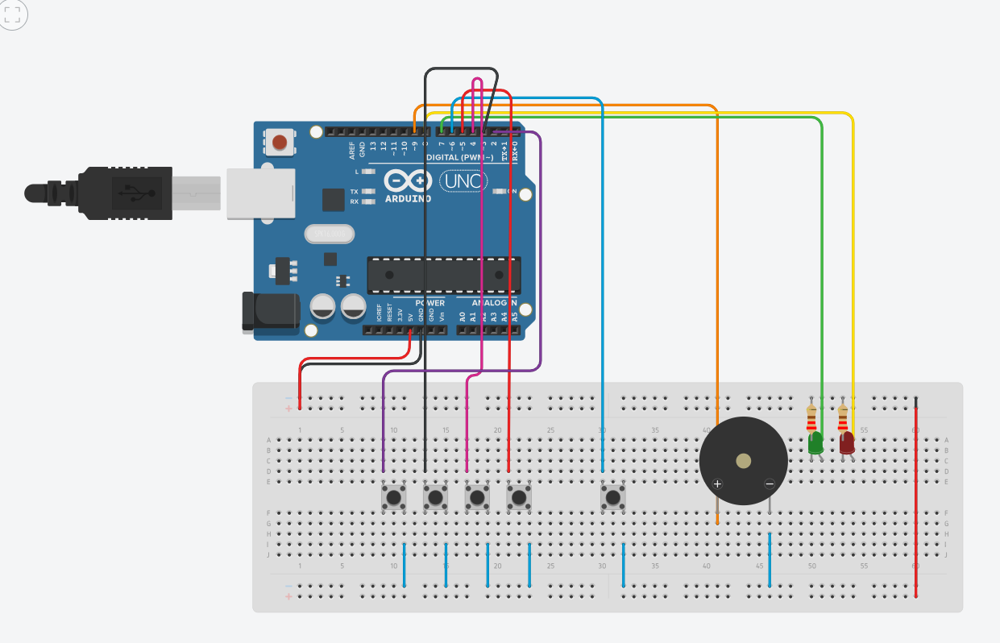

# Vault Protection System (FSM-Based Access Control)

Developed as part of the **Computer Organization** curriculum at the **German International University (GIU)**.

## Circuit Schematic & Simulation

## Features
- **Finite State Machine (FSM)** architecture managing states: `ENTERING`, `ACCEPTED`, `REJECTED`, and `BLOCKED`.
- **Debounce & Hold-to-Repeat Logic:** Non-blocking millisecond-based button handling.
- **Hardware Peripherals:** Pushbuttons with internal pull-ups (`INPUT_PULLUP`), RGB/dual LED indicators, and active buzzer PWM alarms.
